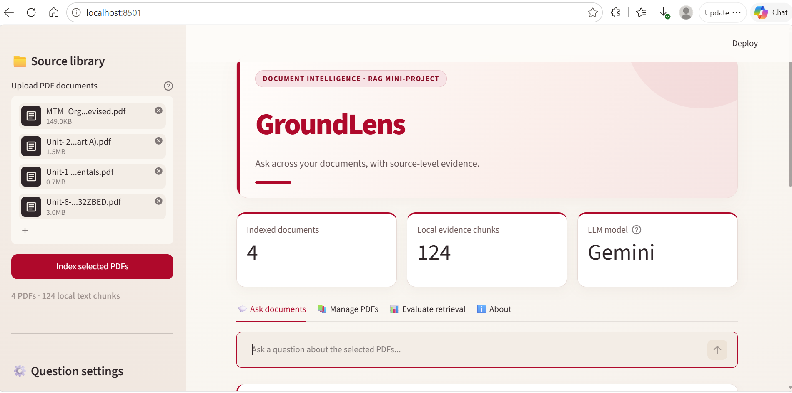
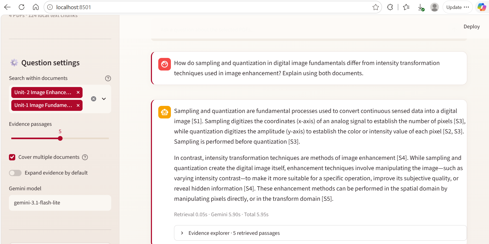

# GroundLens

### Evidence-grounded question answering across your PDFs

A working academic **Retrieval-Augmented Generation (RAG)** application that combines local PDF processing, CPU-based sentence embeddings, a persistent ChromaDB index and Gemini answer generation. Search a selected document set, ask questions, and inspect the retrieved text with its original filename and page number.

**Python · Streamlit · PyMuPDF · Sentence Transformers · ChromaDB · Gemini**



[Final Project Report](docs/docs/report/C033_GroundLens_Final_Report.docx)· [Architecture](docs/ARCHITECTURE.md) · [Recorded results](docs/TESTING.md) · [Screenshots](screenshots/README.md)

## What this project implements

| Capability | Implementation |
|---|---|
| Multi-PDF indexing | Selectable text extraction, page-aware chunks and SHA-256 duplicate detection. |
| Local semantic retrieval | CPU embeddings with `all-MiniLM-L6-v2` and persistent ChromaDB storage. |
| Source selection | Search only selected PDFs; selecting fewer files does not delete their indexes. |
| Cross-document queries | Optional document-diversity heuristic for the retrieved evidence set. |
| Grounded generation | Gemini receives labelled excerpts, the question and limited recent context, not an upload of the original PDF. |
| Inspectable evidence | Response-specific `[S1]` citations, source filenames, one-based page numbers and vector distances. |
| Evaluation | Separate retrieval/generation timings, retrieval-only benchmark code and automated unit tests. |
| User interface | Red, ivory and pale-rose Streamlit interface, document management and session chat history. |

This is an application built around pretrained models, **not a newly trained language model**. The course covers Pinecone, LangGraph and observability platforms, but this implementation uses ChromaDB and direct Python orchestration. It does not claim LangGraph, LangSmith, Langfuse, hybrid search or a reranker.

## Quick start — Windows

The recorded local setup used **64-bit Python 3.11, 8 GB RAM and no dedicated GPU**. Internet access is required for the initial embedding-model download and for Gemini generation. Start in this repository's root folder, where `app.py` is located.

```powershell
py -3.11 -m venv .venv
.\.venv\Scripts\python.exe -m pip install -r requirements.txt
Copy-Item .env.example .env
notepad .env
```

In the local `.env` file, replace only the key placeholder with your own Google AI Studio key:

```dotenv
GEMINI_API_KEY=REPLACE_WITH_YOUR_OWN_API_KEY
GEMINI_MODEL=gemini-3.1-flash-lite
```

Then launch:

```powershell
.\.venv\Scripts\python.exe -m streamlit run app.py
```

Open `http://localhost:8501` when the browser does not open automatically. Subsequent Windows launches can also use `run_windows.bat` after completing setup.

The default model ID preserves the configuration used in the recorded tests; it is configurable, not a guarantee of future model availability. Never commit `.env`, an actual API key or your local `runtime/` index. The supplied `.env.example` contains a placeholder only.

<details>
<summary>macOS / Linux setup (not the recorded test environment)</summary>

Use Python 3.11 in a virtual environment:

```bash
python3.11 -m venv .venv
.venv/bin/python -m pip install -r requirements.txt
cp .env.example .env
# Edit .env locally to provide your own Gemini key.
.venv/bin/python -m streamlit run app.py
```

</details>

## Try the included demonstration documents

The repository contains **three original synthetic PDFs** in `sample_documents/`. They describe a fictional event, its amendment and a previous-year archive. No full college lecture PDFs or indexed lecture text are distributed.

Upload the three sample PDFs and click **Index selected PDFs**. Then choose the relevant document scope under **Search within documents**.

| Question | Document scope / expected result |
|---|---|
| What was the registration fee in the original 2026 circular? | Original 2026 PDF: INR 250 per person, page 1. |
| What is the revised 2026 registration fee? | 2026 amendment: INR 300 per person, page 1. |
| Compare the original and revised 2026 registration fees. | Select both 2026 PDFs and enable **Cover multiple documents**; retrieve evidence for 250 and 300. |
| What was the 2025 registration fee? | 2025 archive: INR 180 per person, page 1. |
| What is the event Wi-Fi password? | No password is supplied; the system should not invent one. |

These are **test expectations**, not additional recorded application results. The amendment explicitly changes the 2026 registration fee and deadline; it does not replace every other policy. See [testing instructions](docs/TESTING.md) before running the benchmarks.

## Architecture

**Indexing:** PDF → page-level text → overlapping chunks → local embeddings → ChromaDB.

**Answering:** question and source scope → local query embedding → filtered retrieval → labelled evidence prompt → Gemini → answer and evidence explorer.

The implementation uses 170-word chunks with 35-word overlap. The recorded academic queries used five retrieved passages. In document-coverage mode, the candidate pool is expanded and source diversity is encouraged; neither complete source coverage nor complete answer coverage is guaranteed.

[View the workflow diagram from the final report](docs/images/workflow.png).

## Recorded academic demonstration

The final local index contained **4 PDFs, 99 pages and 124 chunks across 3 subject areas**: Management Through Movies, Image and Video Processing, and Software Engineering. The two image-processing units are separate files in the same subject area. The full lecture PDFs are not included in this public package.

| Test | Question focus | Outcome | Retrieval (s) | Gemini (s) | Total (s) |
|---|---|---|---:|---:|---:|
| Q1 | External and internal change drivers | Pass | 17.41 | 8.69 | 26.10 |
| Q2 | Four categories of resistance | **Fail: incorrect abstention** | 0.73 | 18.32 | 19.05 |
| Q3 | Economic resistance | Pass | 0.05 | 8.08 | 8.13 |
| Q4 | Gamma transformation | Pass | 0.05 | 5.41 | 5.46 |
| Q5 | Digitization versus image enhancement across two PDFs | Pass | 0.05 | 5.90 | 5.95 |

These are five **user-observed manual functional tests**, not a representative accuracy benchmark. Four answers passed the main content check; this does not establish that every citation was semantically verified. Mean total time was 12.94 s and median total time was 8.13 s for these five individual runs. See [the test record](docs/TESTING.md) and [machine-readable observations](evaluation/observed_v2_tests.csv).

### An observed limitation, not a hidden failure

For Q2, the relevant explanations existed on pages 8–10 of the Organizational Change document. Retrieval returned pages 18, 2, 10, 7 and 3, missing the key pages 8–9. Gemini then abstained too broadly rather than providing a qualified partial answer. The later focused economic-resistance question succeeded. This illustrates the distinction between **information missing from the retrieved excerpts** and **information missing from the uploaded document**.

### Cross-document evidence



Expanded evidence in [Image Fundamentals](screenshots/06-fundamentals-evidence.png) and [Image Enhancement](screenshots/07-enhancement-evidence.png) confirms retrieval from both selected PDFs. The answer succeeds at the main digitization-versus-enhancement distinction; it is not an exhaustive mathematical comparison.

## Tests and benchmark status

```powershell
.\.venv\Scripts\python.exe -m pytest -q -ra
```

Packaging verification: **13 unit tests passed; 1 ChromaDB integration test was skipped** because ChromaDB was unavailable in the packaging environment. This is separate from the recorded laptop results above. Live Gemini, neural embedding retrieval and the complete UI were not rerun during packaging. See [verification notes](docs/PACKAGE_VERIFICATION.md).

For a retrieval benchmark using distributed data, upload the three synthetic PDFs, open **Evaluate retrieval**, and choose **Fictional event (original demo)**. This tests document/page/phrase retrieval without Gemini calls; its output is not answer accuracy.

**Legacy dataset warning:** the UI's **Four academic subjects** option still refers to an older dataset containing Game Design. It does not match the final four-PDF corpus, which uses Image Enhancement instead. It is retained to keep the demonstrated application code unchanged. Do not present this legacy dataset's output as evaluation of the final corpus. Filenames and expected passages must be aligned before such a benchmark is run.

## Limits, privacy and security

- Scanned/image-only PDFs need an externally prepared searchable text layer. Built-in OCR and visual interpretation of diagrams are not implemented.
- Citation-ID validation is syntactic, not a fact-checker. Grouped references are not fully parsed. Similarity distance is not an answer-confidence percentage.
- The cloud prompt includes the question, retrieved excerpts and limited recent question/answer context. The application is not fully offline and is intended for a local, single-user session.
- Document coverage, contradictions, prompt-injection resistance and abstention are best-effort behaviours, not guarantees. Multi-part questions can miss essential pages.
- API availability, quota and networking can affect generation. A 503 high-demand response was observed before a later successful run.

Further details: [privacy and data handling](docs/PRIVACY.md). No public hosted application or repository-wide open-source licence is claimed. Third-party dependencies, pretrained models, lecture excerpts and institutional marks retain their respective rights; the theme does not imply institutional endorsement.

## Repository layout

```text
groundlens-rag/
├── app.py
├── check_gemini.py
├── requirements.txt
├── run_windows.bat
├── .env.example
├── .gitignore
├── .streamlit/config.toml
├── rag/                    PDF processing, vector storage, retrieval and generation
├── evaluation/             Benchmarks, checklists and observed test records
├── tests/                  Unit and ChromaDB integration tests
├── sample_documents/       Three synthetic demonstration PDFs
├── screenshots/            Seven genuine application captures
└── docs/                   Architecture, results, privacy and the final report
```

The [Final Project Report](docs/docs/report/C033_GroundLens_Final_Report.docx) is included . 

**Author:** Aryan Paode · C033 · Computer Engineering · MPSTME, NMIMS · Academic Year 2026–27.

**Course:** RAG Systems & Agentic Workflows with Pinecone and LangGraph (Coursera).
