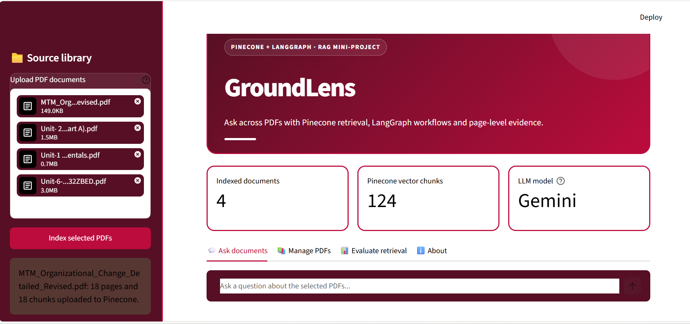
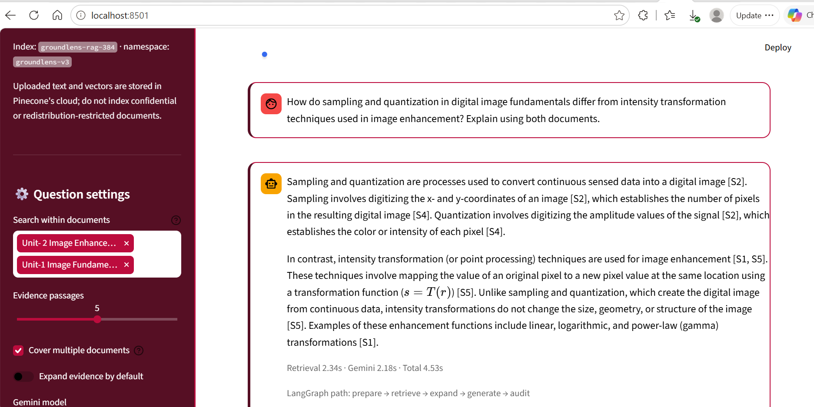

# GroundLens
### Evidence-Grounded Multi-Document Question Answering
**Pinecone · LangGraph · Gemini · Streamlit**

GroundLens answers natural-language questions across selected PDF documents and shows the passages used to construct each answer. PDF extraction and sentence embeddings run locally on the CPU; **Pinecone** stores and searches the text-bearing vectors; a **LangGraph StateGraph** coordinates retrieval, optional query expansion, generation and citation-label checks; **Gemini** generates the response.

**Aryan Paode · C033 · BTI–Computer Engineering · Semester 9, Division B · MPSTME, NMIMS**

[Final project report](docs/report/C033_GroundLens_Final_Report.docx) · [Architecture](docs/ARCHITECTURE.md) · [Recorded results](evaluation/recorded_results.csv) · [Screenshot evidence](screenshots/README.md) · [Testing guide](docs/TESTING.md)



## What the application implements

| Component | Responsibility |
|---|---|
| PDF ingestion | PyMuPDF extracts selectable text with one-based page references. |
| Page-aware chunking | At most 170 words per chunk, with a 35-word overlap within each page. |
| Local embeddings | `sentence-transformers/all-MiniLM-L6-v2`, 384 dimensions, CPU execution. |
| Pinecone retrieval | Dense cosine-similarity index, namespace isolation and selected-document metadata filters. |
| LangGraph workflow | `prepare`, `retrieve`, `expand`, `generate`, `abstain` and `audit` nodes with conditional routing. |
| Gemini generation | Answers from labelled excerpts and at most two recent conversation turns. |
| Evidence explorer | Source filename, original page, retrieved text and similarity for each response-specific citation. |
| Evaluation | Recorded manual answers, stage timings, graph paths and a separate retrieval-only benchmark utility. |

This is not a whole-PDF upload to Gemini, an offline LLM, or an autonomous planning agent. Query expansion uses transparent pattern-based rules. The `audit` node checks recognized source numbers; it is not a factual-verification model.

## Architecture


### Conditional LangGraph routing


The recorded session exercised these two routes:

```text
prepare -> retrieve -> generate -> audit
prepare -> retrieve -> expand -> generate -> audit
```

When comparison hints exist, `expand` performs additional filtered searches before choosing a bounded evidence set. If no evidence remains, the graph follows `abstain -> audit` without a Gemini generation call.

## Run locally on Windows

The documented environment is **Python 3.11, 8 GB RAM, no dedicated GPU**. Internet access and separate Pinecone and Gemini API keys are required. Model weights may download on first use.

From the extracted project folder, run:

```powershell
py -3.11 -m venv .venv
.\.venv\Scripts\python.exe -m pip install -r requirements.txt
Copy-Item .env.example .env
notepad .env
```

The copy command above is for a **new installation only**. Do not overwrite an existing working `.env`.

In `.env`, replace the two private-key placeholders. Retain the other settings unless deliberately configuring a different index or namespace. The supplied default model is `gemini-3.1-flash-lite`, the model used in the recorded session; continued provider availability is not guaranteed.

| Setting | Use |
|---|---|
| `GEMINI_API_KEY` | Private Google AI Studio key; never publish it. |
| `GEMINI_MODEL` | Generation model configured for your account. |
| `PINECONE_API_KEY` | Private Pinecone key; never publish it. |
| `PINECONE_INDEX` | Dense index for 384-dimensional external vectors and cosine similarity. |
| `PINECONE_NAMESPACE` | The namespace containing this installation's records. |
| `PINECONE_CLOUD`, `PINECONE_REGION` | Cloud and region used if index creation is required and permitted. |

```powershell
.\.venv\Scripts\python.exe -m pytest -q
.\.venv\Scripts\python.exe check_pinecone.py
.\.venv\Scripts\python.exe -m streamlit run app.py
```

Open `http://localhost:8501`. Upload your permitted text-selectable PDFs, click **Index selected PDFs**, select the search scope and ask a question. The default evidence count is five. For comparisons across files, select those files and enable **Cover multiple documents**.

The dashboard's document/chunk counts are based on a private local manifest. Preserve `runtime/pinecone_manifest.json` with your working installation and keep the configured index/namespace unchanged. Deleting the local manifest does **not** delete remote vectors. This publication package intentionally contains no manifest; a fresh installation must index its own permitted documents.

## Recorded evaluation

The documented academic library contains **4 PDFs, 99 pages and 124 indexed chunks**, across three subject areas. The full lecture PDFs are not distributed here.

| Question | Manual outcome | Retrieval (s) | Gemini (s) | Total (s) | `expand` executed |
|---|---|---:|---:|---:|---|
| External/internal change drivers | Pass | 1.91 | 4.87 | 8.80 | No |
| Four resistance categories | Pass | 3.15 | 3.33 | 6.68 | Yes |
| Economic resistance | Pass | 1.27 | 1.56 | 2.85 | No |
| Gamma transformation | Pass | 1.25 | 2.03 | 3.28 | No |
| Sampling/quantization vs point processing | Pass | 2.34 | 2.18 | 4.53 | Yes |

**Five selected questions passed manual content review.** Mean displayed total time: **5.23 s**; median: **4.53 s**. These are individual observations from 15 October 2026, not a general accuracy estimate or controlled latency benchmark. Outer total time includes resource access and orchestration, so it need not equal the sum of the two node timers.

Q1–Q4 searched all four documents. Q5 searched only the two image-processing PDFs. Expanded evidence is available partly for Q1 and for the principal claims in Q4 and Q5. Q2/Q3 citations are visible, but their source panels were not expanded in the supplied captures.

The supplied Windows setup log reported **23 automated tests passed in 1.66 s**. These are code tests, not 23 live cloud-answer trials. The independent checks of this publication package are recorded in [Package verification](docs/PACKAGE_VERIFICATION.md).

### Cross-document execution evidence



The source captures show Image Fundamentals pages 6–7 and Image Enhancement pages 11–12. One retrieved result is the enhancement title page; it contributes no substantive explanation and is not cited in the generated answer. See the [evidence catalogue](screenshots/README.md) for all fifteen original captures.

## Test data and benchmark boundaries

`evaluation/recorded_results.csv` contains the five actual answer observations. `evaluation/academic_benchmark.csv` contains **24 prepared test questions**, not completed benchmark results. Its expected filenames must match the indexed filenames exactly. It calls Pinecone retrieval, not the complete LangGraph answering graph, and it does not call Gemini.

Three fictional event PDFs and their 22-question dataset are included only for optional reproducibility and automated sample-integrity tests. They are not the corpus used for the five reported academic answers. Their text deliberately identifies them as synthetic.

## Limitations and data handling

Text-only PDF extraction does not interpret scanned pages, pictures or formula images. Multi-column text can lose structure. Expansion is heuristic and can miss relevant passages; similarity is not answer confidence. Citation-number auditing does not establish factual entailment. The five-question session does not validate adversarial behavior or all missing-information paths.

**Data leaves the laptop:** Pinecone stores extracted passages, embeddings and metadata. Gemini receives the question, selected excerpts and limited conversation context. Use only material permitted for those services. Keep API keys in `.env`, never in source code, screenshots or commits. See [Data handling](docs/PRIVACY.md).

## Repository layout

```text
groundlens-rag/
├── app.py
├── check_pinecone.py
├── check_gemini.py
├── requirements.txt
├── .env.example
├── .gitignore
├── .streamlit/config.toml
├── rag/
│   ├── pdf_processing.py
│   ├── pinecone_store.py
│   ├── retrieval_utils.py
│   ├── workflow.py
│   └── generation.py
├── evaluation/
│   ├── academic_benchmark.csv
│   ├── recorded_results.csv
│   └── benchmark.py
├── tests/
├── sample_documents/
├── screenshots/
└── docs/
    ├── images/
    └── report/C033_GroundLens_Final_Report.docx
```

The report, diagram files, source code, genuine captures and recorded measurements describe the same GroundLens application. The example namespace and model identifiers are retained for configuration compatibility; do not change identifiers in a working installation merely to rename a project folder.
