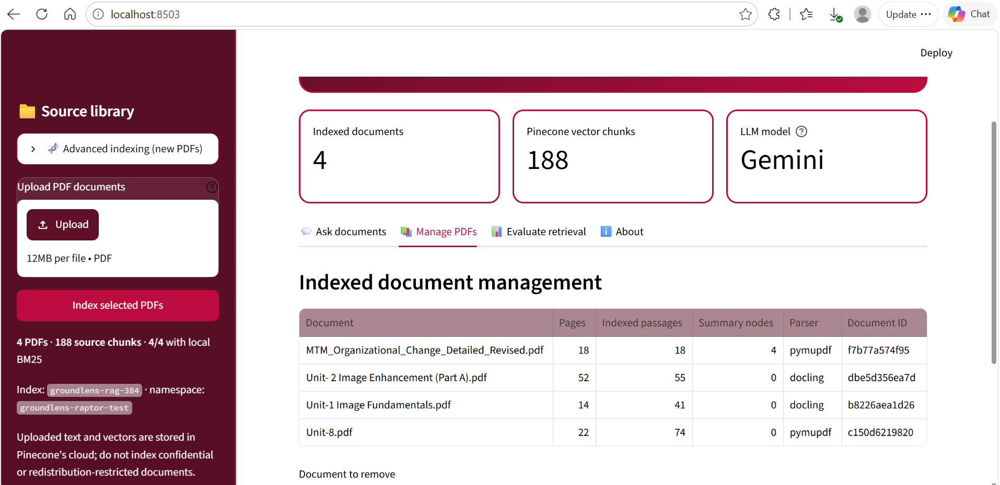
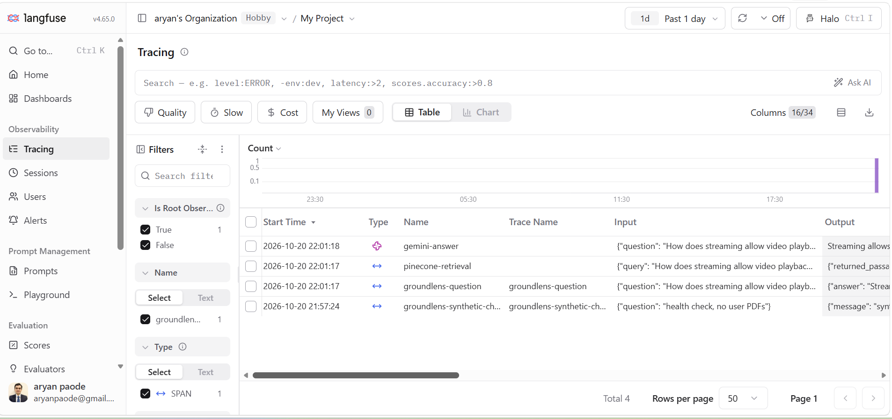

# GroundLens
### Adaptive Multi-Document Question Answering

Upload permitted PDF documents, select sources, ask a question, and inspect the answer with original-page evidence. GroundLens combines **Pinecone, LangGraph and Gemini** with optional advanced indexing, retrieval, optimization, evaluation and tracing.

**Aryan Paode · C033 · MPSTME–NMIMS · October 2026**

[Project report](docs/report/C033_GroundLens_Final_Report.docx) · [Windows setup](START_HERE.md) · [Architecture](docs/ARCHITECTURE.md) · [Recorded evidence](docs/RESULTS.md) · [Privacy](docs/PRIVACY.md)



## Implemented stack

| Layer | Implementation |
|---|---|
| Interface | Streamlit; PDF upload, source filters, chat and evidence explorer |
| Document processing | PyMuPDF or optional IBM Docling; fixed-size or embedding-aware semantic chunks |
| Index enrichment | Optional bounded contextual descriptions and RAPTOR-inspired summary hierarchy |
| Embeddings and storage | CPU MiniLM, 384 dimensions; Pinecone dense cosine index; local SQLite FTS5 companion |
| Retrieval | Dense search; optional dense + BM25 Reciprocal Rank Fusion; summary-to-source retrieval; CPU Cross-Encoder reranking |
| Control flow | LangGraph with heuristic query decomposition, corrective retrieval, HyDE, generation, abstention and citation-label checks |
| Prompt optimization | Optional DSPy MIPROv2; saved JSON program required for optimized generation |
| Evaluation | Retrieval benchmarks and separate RAGAS 0.3.9 Gemini-judge runner |
| Observability | Opt-in Langfuse root, retrieval and generation observations |

This is document question answering, not a web-search service or model-training application. RAPTOR-inspired indexing is not the exact research implementation. Hybrid search uses **local BM25**, not native Pinecone sparse indexing. The corrective branch searches selected documents; it does not browse the web.

## Run on Windows

Python 3.11, 64-bit is the demonstrated environment. For a clean installation:

```powershell
py -3.11 -m venv .venv
& .\.venv\Scripts\python.exe -m pip install -r requirements.txt
Copy-Item .env.example .env
notepad .env
& .\.venv\Scripts\python.exe -m streamlit run app.py --server.port 8503
```

Set private Gemini and Pinecone credentials in `.env`. Langfuse is OFF by default; configure its keys and `GROUNDLENS_LANGFUSE_ENABLED=1` only to opt in. The model name is configurable. The example retains the Gemini model used in the supplied live execution; availability and quota are account-dependent.

Optional main-app tools:

```powershell
& .\.venv\Scripts\python.exe -m pip install -r requirements-advanced.txt
```


## Recorded results and boundaries

The supplied final captures show **4 PDFs, 106 pages, 188 source passages and 4 separate summary nodes**. RAGAS faithfulness completed with **1.0000 for one answer**; this is not overall accuracy. The Langfuse dashboard received a real `groundlens-question` with retrieval and Gemini observations. See [results](docs/RESULTS.md) for filenames and limitations.



Screenshot evidence establishes the recorded demonstrations; it is not a guarantee that every optional component improves quality or latency. The documented DSPy control was faster without DSPy. Contextual=True records the indexing option, not that all 74 Unit-8 chunks were contextualized. Token usage is reported only when returned by the provider.

## Tests

```powershell
& .\.venv\Scripts\python.exe -m pip install -r requirements-tests.txt
& .\.venv\Scripts\python.exe -m pytest -q
```


## Repository contents

- `app.py`, `rag/`: application and advanced RAG modules.
- `evaluation/`, `scripts/`, `tests/`: evaluation runners, utilities and automated tests.
- `docs/report/`: the updated 38-page report, copied unchanged from the delivered document.
- `screenshots/advanced/`: curated advanced execution evidence; `screenshots/session/`: supplied original session images.
- `sample_documents/`: clearly labelled fictional PDFs, not institutional lecture files.
- `requirements-ragas.txt`: separate evaluation-environment dependency constraints.

