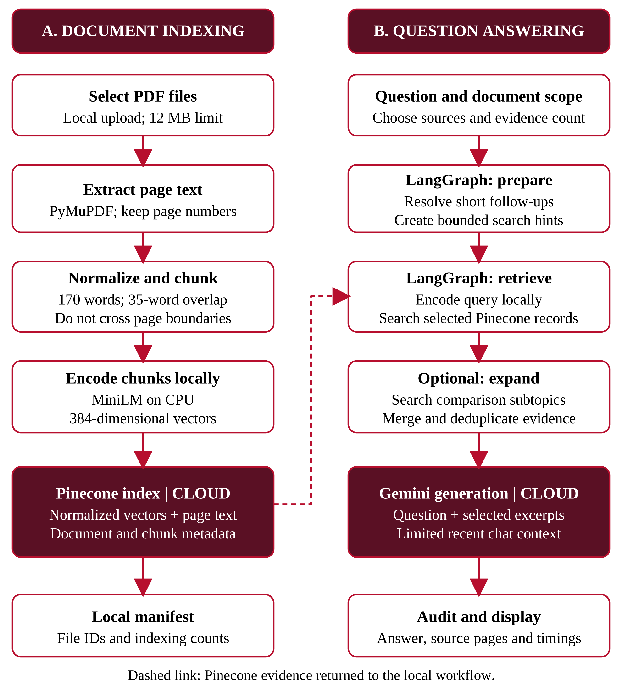
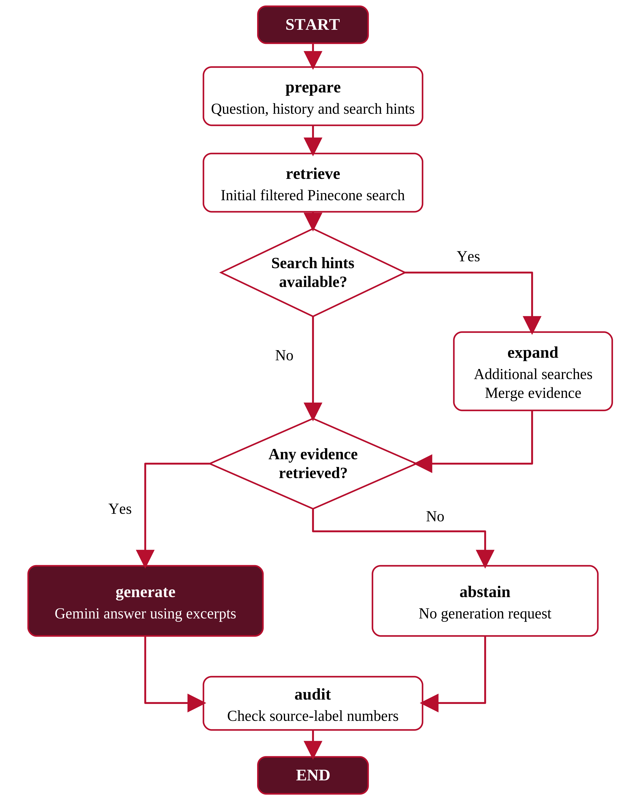

# GroundLens architecture

[Project README](../README.md) · [Final report](report/C033_GroundLens_Final_Report.docx)

## Ingestion and storage

PyMuPDF reads each PDF page separately. Normalized selectable text is split into page-local chunks of at most 170 words, with 35 words of overlap. A SHA-256 hash of the PDF bytes identifies duplicate documents. MiniLM encodes normalized 384-dimensional vectors on the CPU.

`PineconeVectorStore` validates a dense, 384-dimensional cosine index. Each upsert includes the embedding and source metadata: document ID, filename, page number, chunk number, page count and text. Deterministic record IDs identify the document/page/chunk. Upserts use batches of up to 50 records.

The local JSON manifest tracks indexed documents and counts; it does not contain the extracted passages. Pinecone contains the searchable records. Original PDF files are not stored by the application as part of the index. Both the namespace and manifest must remain consistent with the working installation.

## LangGraph shared state

`QAState` carries the question, selected document IDs, top-k count, coverage flag, recent history, retrieval query, comparison hints, retrieved `SearchHit` objects, generated answer, stage timings, source-number warnings and execution path.

| Node | Operation |
|---|---|
| `prepare` | Resolve short follow-ups heuristically and derive bounded comparison hints. |
| `retrieve` | Encode the query and call filtered Pinecone retrieval. |
| `expand` | Search the hinted topics, prefer explicit terminology within each candidate set and merge distinct passages. |
| `generate` | Ask Gemini to answer from labelled excerpts and bounded recent context. |
| `abstain` | Return an insufficient-information message without generation when no evidence remains. |
| `audit` | Flag recognized standalone source numbers outside the supplied evidence range. |

After `retrieve`, comparison hints take priority and route to `expand`. Otherwise, nonempty hits route to `generate` and empty hits to `abstain`. After expansion, the presence of evidence determines generation versus abstention. Both answer paths finish at `audit`, then END.

## Retrieval controls

Ordinary search keeps k nearby passages. Coverage mode requests a larger candidate pool and reserves a result per distinct document encountered before filling remaining slots. Neither guarantees complete coverage. Expansion selects at most eight final passages, normally the greater of k and the number of hints. No extra LLM planner is used.

`SearchHit.distance = 1 - cosine_similarity`. Similarity expresses embedding proximity, not probability of correctness.

## Generation and checks

The configured Gemini request uses a 60,000 ms timeout, one SDK attempt, temperature 0.1 and a maximum 1,200 output tokens. The prompt contains the question, labelled source excerpts and at most two recent turns. Prior answers are context, not factual evidence. Source text is treated as untrusted data.

The syntactic audit does not prove factual support and does not fully parse every grouped-citation format. There is no separate automatic fact-checking model, persistent LangGraph checkpointer, integrated Pinecone embedding service, LangSmith trace service or built-in OCR.

## Timing

Retrieval seconds are accumulated inside `retrieve` and `expand`. Gemini seconds measure the generation call. Total seconds wrap resource access, graph compilation/invocation and orchestration. Preserve the displayed total rather than recalculating it from rounded node timings.
