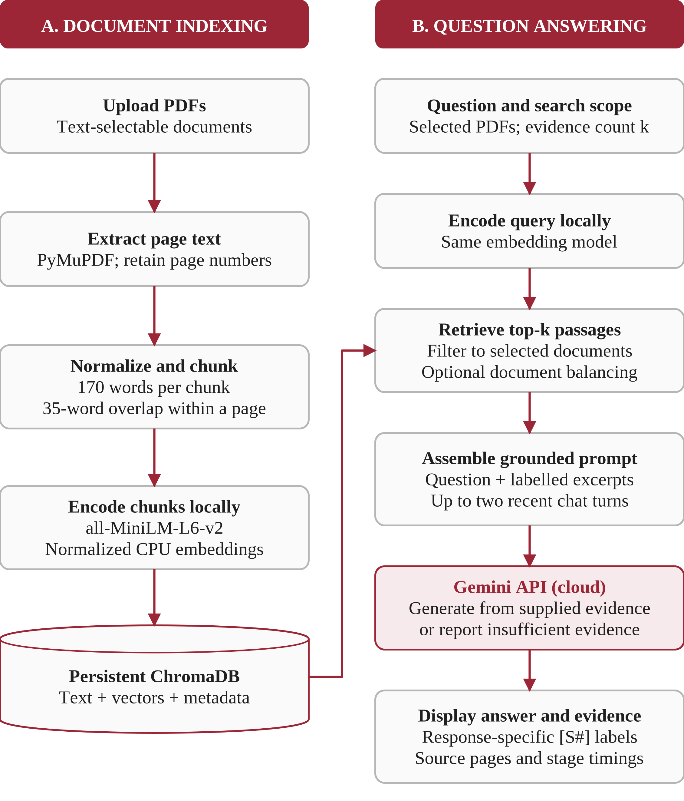

# Implemented architecture

This diagram is the same figure used in the final report. It represents the delivered Python implementation, not a new feature added for this repository.

## Indexing path

`rag/pdf_processing.py` extracts text with PyMuPDF, normalizes whitespace and creates page-bounded chunks of at most 170 words with 35 words of overlap. One-based page references are kept. Files without selectable text cannot be indexed.

`app.py` caches a CPU `sentence-transformers/all-MiniLM-L6-v2` model. `rag/vector_store.py` uses the SHA-256 file hash for duplicate recognition, embeds chunks, and stores text and metadata in a ChromaDB `PersistentClient` collection named `groundlens_pdf_chunks` under `runtime/chroma/`.

Stored fields include document ID, filename, page, chunk number and total PDF pages. The original PDF is not retained by the indexing code, but the index contains extracted text and is therefore excluded from the public repository.

## Question-answering path

The selected document IDs are applied as a database filter. A query embedding is searched against the stored vectors. Ordinary mode returns the closest `k` passages; **Cover multiple documents** expands the candidate pool, attempts to reserve passages from different documents, and fills the remaining positions. It is a diversity heuristic, not a guarantee of finding all necessary evidence.

`rag/generation.py` labels excerpts `[S1]`, `[S2]`, etc. and includes source filenames and pages. The Gemini prompt also contains the current question and at most two recent question-answer turns. Earlier generated answers are marked as context rather than evidence. A short-follow-up heuristic can prepend the prior question to the retrieval query.

The generation settings in the supplied application are `temperature=0.1`, `max_output_tokens=1200`, `timeout=60000` milliseconds and one SDK attempt. The default model is the one used in the recorded tests, `gemini-3.1-flash-lite`.

## Output and limits

The interface shows the answer, response timings and an evidence explorer. Citation checks recognize standalone `[S#]` labels and test whether their numbers exist in the current evidence list. They do not establish semantic support and do not fully parse grouped citation formats.

The local/cloud boundary is at prompt submission: the question, selected text and limited history go to Gemini. PDF parsing, indexing and retrieval remain local. There is no LangGraph agent, built-in OCR, reranking model, live web search or independent answer-verification service.
